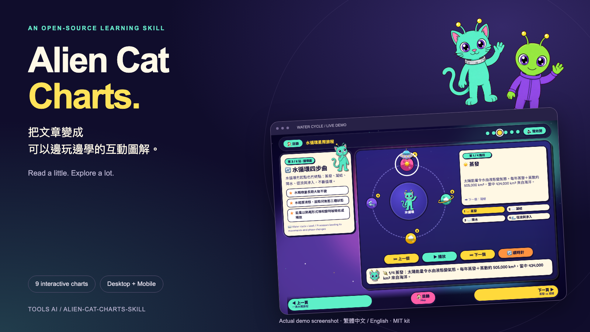
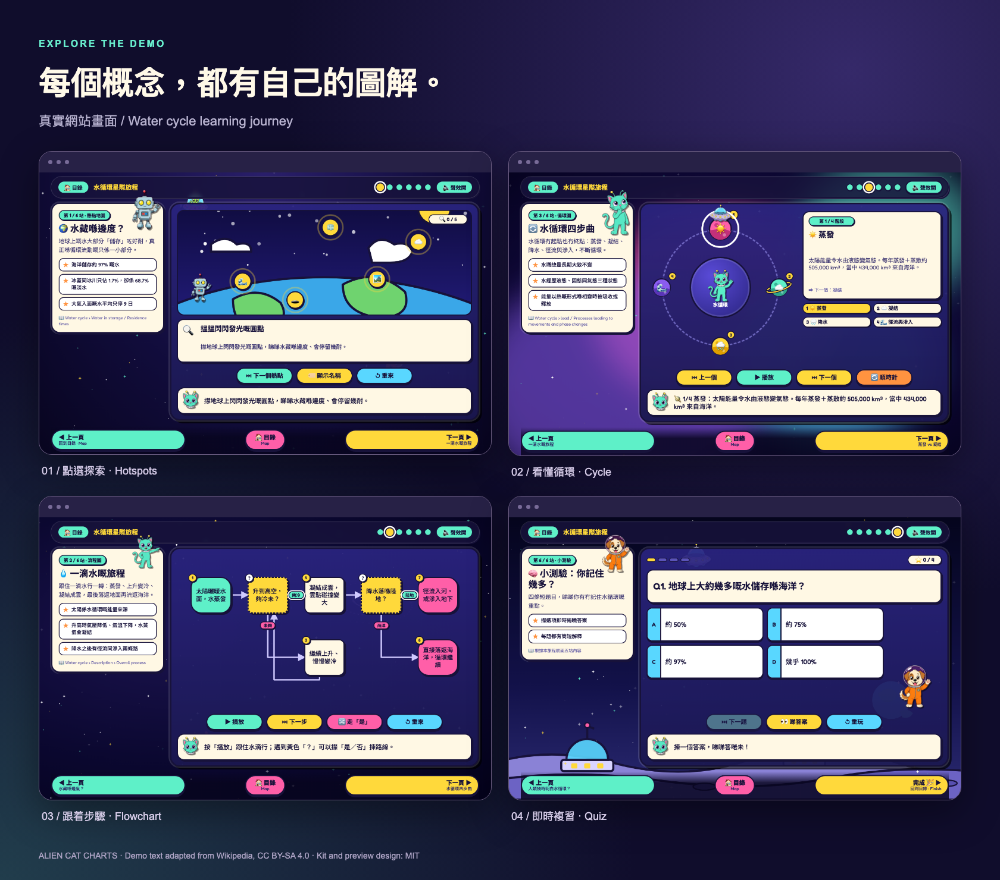
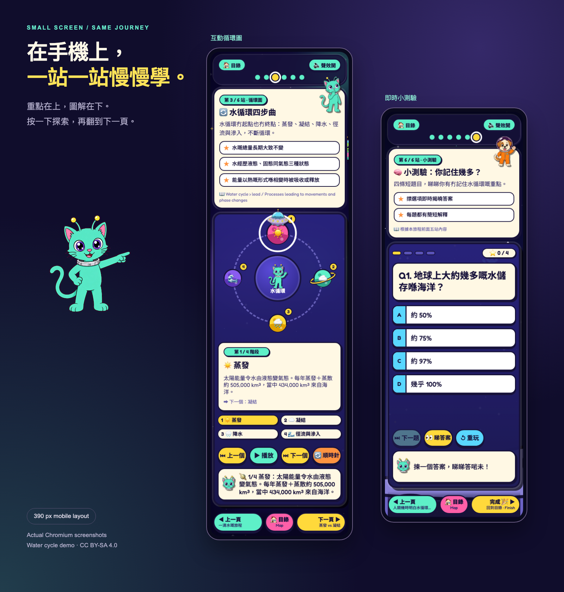

<div align="center">

# 👽 Alien Cat Charts

**把文章變成可以邊玩邊學的互動圖解網站。**

給 AI Agent 使用的 Skill · 繁體中文 / English · 電腦 / 手機

[快速開始](#快速開始) · [下載示範](examples/water-cycle-site.zip) · [9 種圖解](#可以做甚麼) · [English](#english)



</div>

## 這是甚麼？

把網址、文章、文件或筆記交給 AI，讓它按原文順序整理重點，製作一個有**外星人、太空貓和互動圖表**的學習網站。

每站只講一個概念：讀幾句重點、操作圖解，再用小測驗檢查理解。適合把長文章拆成容易消化的小段，或製作教學、流程說明及複習材料。

這是一套 **AI 操作指南 + 網站產生工具**。需要由 AI 閱讀和整理內容；Python 工具負責把整理好的資料變成網站。

## 看看實際效果

水循環示範：6 站、6 種圖解。以下均為真實網站截圖。





[下載水循環示範 ZIP](examples/water-cycle-site.zip)，解壓後開啟 `index.html` 即可體驗。

## 可以做甚麼？

| 圖解 | 適合內容 | 操作方式 |
| --- | --- | --- |
| 流程圖 | 步驟、判斷、分支 | 逐步播放、選擇路線 |
| 時間軸 | 歷史、發展、先後次序 | 沿時間線探索 |
| 漫畫 | 故事、對話、例子 | 逐格閱讀 |
| 循環圖 | 水循環、反覆發生的過程 | 點選階段、播放循環 |
| 小測驗 | 檢查理解 | 選答案、看解釋 |
| 對比卡 | A / B、前後差異 | 逐行揭開 |
| 熱點地圖 | 部件、位置、名詞探索 | 點選熱點看說明 |
| 任務清單 | 要求、待辦、學習確認 | 勾選並查看進度 |
| 翻翻卡 | 詞語、定義、複習 | 點擊翻面 |

另外附有 12 個角色、6 種太空背景、旅程目錄、逐頁導航，以及預設關閉的原創環境聲效。

## 快速開始

### 1. 安裝到你的專案

在專案資料夾開啟終端機，執行：

```bash
git clone https://github.com/Toolsai/alien-cat-charts-skill.git .agents/skills/alien-journey
```

這是 **Codex 專案限定安裝**，技能名稱為 `alien-journey`。安裝後在下一則訊息呼叫；若未顯示，重新開啟專案。

其他支援 `SKILL.md` 的 AI 工具，可按其安裝方式放置整個資料夾，或直接請 AI 閱讀本倉庫的 [SKILL.md](SKILL.md)。

### 2. 給 AI 一段內容

```text
$alien-journey

請把下面這篇文章做成繁體中文互動學習網站。
按原文順序分成 4–7 站，每站只講一個重點，最後加小測驗。

[貼上文章、網址或附上文件]
```

### 3. 開啟成果

AI 會交付網站資料夾、ZIP 及畫面預覽。解壓 ZIP，開啟 `index.html`。

- 下方按鈕：上一頁 / 目錄 / 下一頁。
- 鍵盤：`←` `→` 翻頁，`Home` 回目錄。
- 右上角「🔇 開啟宇宙聲效」：自行開啟聲音。

## 在本機製作示範

需要 Python 3。以下指令在本倉庫根目錄執行，套件只安裝到 `.venv`。

```bash
python3 -m venv .venv
source .venv/bin/activate
pip install -r requirements.txt

python scripts/new_journey.py check src/journey.json
python scripts/build_site.py --journey src/journey.json --out out --zip out.zip --strict
```

開啟 `out/index.html`。內附 `src/journey.json` 是水循環範例；製作自己的版本時，先複製一份再修改。

### 檢查電腦與手機畫面

```bash
pip install -r requirements-test.txt
playwright install chromium
python test.py --site out --shots out-shots
```

測試涵蓋 1280 與 390 像素寬度，檢查互動、導航、文字溢出和聲效，並產生截圖與報告。以報告的 `GREEN ✅` 判斷結果，再自行查看截圖。此測試使用 Chromium；Safari、Firefox 未列入驗證。公開版本的[驗證紀錄](docs/VALIDATION.md)附有測試報告。

## 檔案在哪裏？

- [SKILL.md](SKILL.md)：AI 的完整操作指南。
- [src/journey.json](src/journey.json)：網站內容資料。
- [templates/](templates/)：頁面與 9 種圖解資料範本。
- [scripts/](scripts/)：建立、驗證網站及素材工具。
- [examples/](examples/)：水循環及全圖解範例。
- [assets/](assets/)：角色、背景、樣式、互動程式及聲音。

## 使用前知道這幾件事

- 產出的網站是靜態檔案，沒有後端服務；一般瀏覽器可直接開啟。
- 精確字型需連接 Google Fonts；離線會使用系統字型。
- 此工具整理文章重點，並非逐字翻譯整篇文件；請核對來源、數字和 AI 的摘要。
- 複雜流程建議拆成幾站。長字句應縮短，避免字體過小。
- 建立網站不需要在這套工具內設定 API 金鑰；所用 AI 平台可能另有費用。

## 授權與來源

程式、角色圖片與合成環境音依 [MIT License](LICENSE) 提供，保留原有作者聲明。

**水循環示範文字另依 CC BY-SA 4.0 提供**，改寫自 Wikipedia 的〈Water cycle〉。轉用或修改示範內容時，請保留[來源與授權](examples/water-cycle.SOURCE.md)。預覽中的示範文字亦依此授權；預覽設計本身依 MIT 提供。

自己的文章、文件或外部圖片仍需遵守原有授權。本倉庫不包含使用者的私人文章或學習輸出。

## English

**Turn articles, notes and documents into playful, interactive learning journeys.**

Alien Cat Charts is an AI skill and static-site kit with 9 interactive chart types, 12 characters, 6 space backgrounds, page navigation and optional ambient audio. It supports Traditional Chinese and English, with desktop and mobile layouts.

Install this repository into your project's `.agents/skills/alien-journey`, then ask your agent to use `$alien-journey` with a source article. The agent reads and summarises it; the Python builder renders the site. No API key is required by the builder.

Try the [water-cycle demo](examples/water-cycle-site.zip): unzip and open `index.html`. Code and original assets are MIT licensed; the Wikipedia-derived demo text is CC BY-SA 4.0. See [LICENSE](LICENSE) and [source attribution](examples/water-cycle.SOURCE.md).
